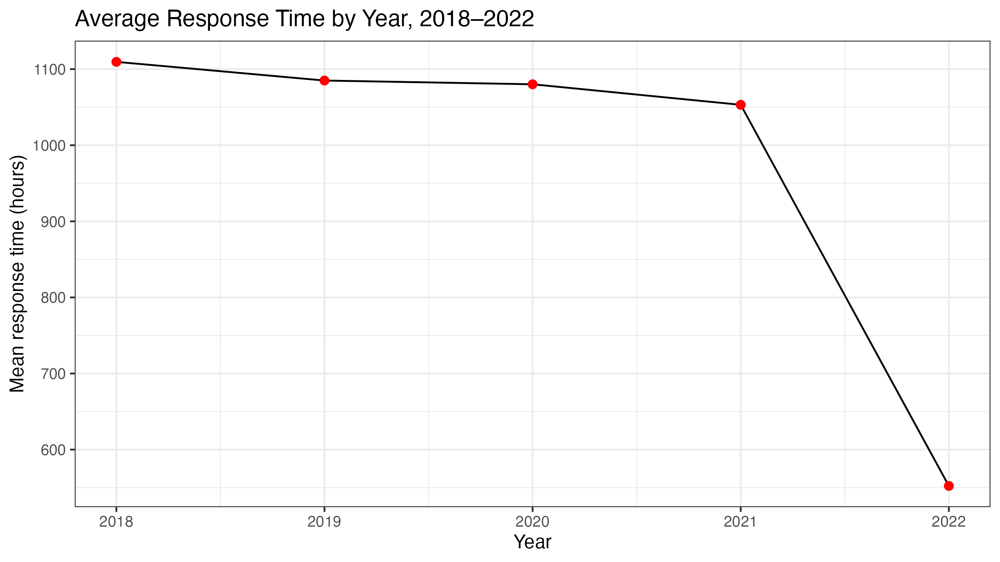
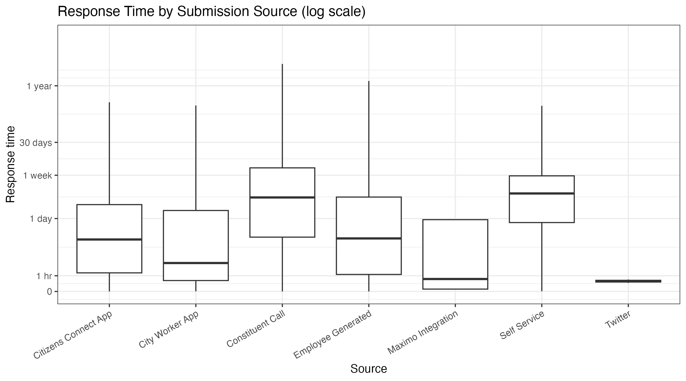
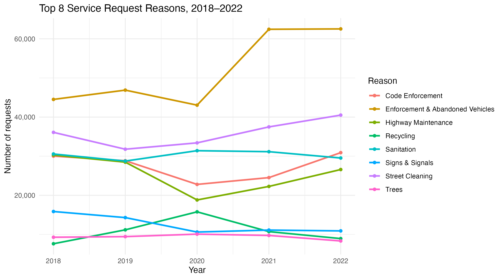
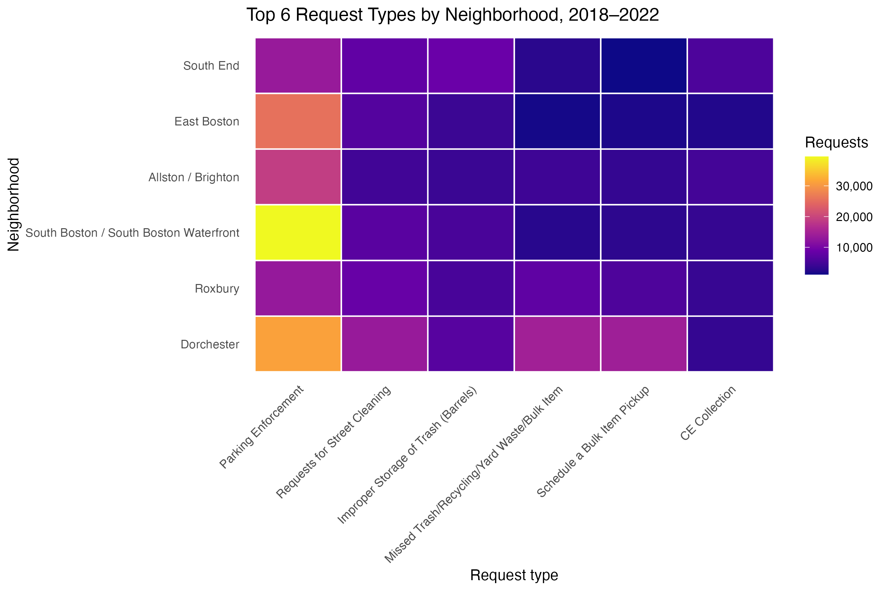

# Boston 311 Service Requests: Response-Time Analysis (2018–2022)

An analysis of **1.3 million** non-emergency service requests made to the City of Boston's 311 system, looking at what drives resolution time and whether the city got faster over five years.

Originally completed as a team project for ALY6015 (Intermediate Analytics) at Northeastern University. I later rebuilt the dataset from the city's source files, cleaned up the code into a reproducible pipeline, and re-ran the analysis. All numbers below come from the current code.

---

## Questions

1. Which request types are most common, and how did they change over time?
2. Do requests resolve faster depending on how they were submitted (app, phone, web)?
3. Did response times improve from 2018 to 2022?
4. Which request types are resolved fastest and slowest?
5. Do neighborhoods report different kinds of issues?

---

## Key findings

**1. The average fell, but the typical request didn't get much faster.**
Mean resolution time dropped about **72 hours per year** (95% CI: 67–77, p < 0.001), after controlling for request type, department, neighborhood and source. That's about 6.5% of the 2018 average per year. But the **median stayed between 12 and 16 hours** in every year, and most of the drop in the mean happened in 2022. The improvement came from fewer extremely long-running cases, not from faster handling of everyday requests.

| Year | Closed requests | Mean (hours) | Median (hours) |
|---|---|---|---|
| 2018 | 238,275 | 1,110 | 15.7 |
| 2019 | 231,720 | 1,085 | 15.5 |
| 2020 | 227,441 | 1,080 | 12.5 |
| 2021 | 253,676 | 1,053 | 11.8 |
| 2022 | 254,720 | 552 | 13.4 |



**2. Requests logged through the City Worker App close faster.**
After controlling for request type, department and neighborhood, City Worker App requests closed about **169 hours faster** than resident app (Citizens Connect) requests (95% CI: 126–213). Typical waits also differ sharply by channel: the median request closed in about 2.5 hours through the City Worker App and 9 hours through the resident app, compared with 62 hours (about 2.6 days) for phone calls and 75 hours (about 3 days) for self-service web reports.



**3. Noise complaints resolve fastest; infrastructure and permit issues resolve slowest.**
The LASSO model ranked request types by their effect on resolution time. The fastest included loud parties, public event noise, aircraft noise and heating fuel assistance. The slowest included sidewalk repair, pavement marking maintenance, illegal use of property and permit violations.

**4. Enforcement requests grew the most.**
Enforcement & Abandoned Vehicles was the largest category every year and jumped sharply in 2021. Street Cleaning requests also rose steadily after 2019.



**5. Neighborhoods report different issues.**
A chi-square test confirmed that request types differ by neighborhood (χ² = 402,548, df = 3,872, p < 0.001). Parking enforcement dominates in South Boston and Dorchester, while Dorchester also generates a large share of trash and bulk-item requests.



---

## What this means

- **Report the median alongside the mean.** The mean alone overstates the improvement. A city dashboard that only tracks averages would credit faster service when the real change was clearing a backlog of old cases.
- **Focus resources on the slow categories.** Sidewalk repair, pavement marking and permit cases are where residents wait longest.
- **Don't read the app result as proof the app causes faster service.** City Worker App requests are often logged by staff who fix the issue on the spot (see Limitations).

---

## Data

- **Source:** [Analyze Boston, 311 Service Requests](https://data.boston.gov/dataset/311-service-requests), yearly CSV files for 2018–2022
- **Size:** 1,300,153 requests, 31 columns
- **Used for modeling:** 1,205,832 closed requests with a valid response time and no missing predictors. The 82,722 requests that were still open were excluded.
- **Response time:** hours between `open_dt` and `closed_dt`

The data isn't included in this repo because the files are too large for GitHub. The city updates these files over time, so a fresh download may give slightly different counts. This version was built in October 2026.

---

## Methods

| Question | Method |
|---|---|
| Request trends | Yearly counts of the top 8 request reasons |
| Submission source | Linear regression of response time on source, alone and with controls |
| Change over time | Linear regression with year, department, neighborhood, request type and source |
| Fastest and slowest types | LASSO regression with 10-fold cross-validation |
| Neighborhood differences | Chi-square test of independence |

---

## How to reproduce

1. Download the 2018–2022 CSV files from [Analyze Boston](https://data.boston.gov/dataset/311-service-requests).
2. Rename them `311_2018.csv` through `311_2022.csv` and put them in `data/raw/`.
3. Open `boston-311-analysis.Rproj` in RStudio.
4. Run `scripts/00_build_dataset.R` to combine the files into `data/boston311_2018_2022.rds`.
5. Run `scripts/01_analysis.R`. Charts are saved to `outputs/figures/` and tables to `outputs/tables/`.

Built with R 4.5.2, using tidyverse, glmnet and broom. Full package versions are in `outputs/session_info.txt`. The full analysis takes about 15–30 minutes, mostly for the LASSO step.

---

## Project structure

```
boston-311-analysis/
├── data/                    # not tracked; see "How to reproduce"
├── scripts/
│   ├── 00_build_dataset.R   # combines yearly files into one dataset
│   └── 01_analysis.R        # models, charts and tables
├── outputs/
│   ├── figures/
│   └── tables/
└── README.md
```

---

## Limitations

- **Open cases are excluded.** Cases still open have no resolution time, so the slowest cases are partly missing. This affects recent years more, since they've had less time to close.
- **Response times are heavily skewed.** Most requests close within a day, but some take years. Linear regression on raw hours is driven by these extreme cases. The median gives a better picture of the typical request.
- **The source comparison isn't causal.** City Worker App and Employee Generated requests are logged by city staff, so they aren't comparable to resident reports. The 169-hour difference is an association after controls, not the effect of the app.
- **The models explain response time poorly.** Cross-validated RMSE is about 3,749 hours. The models are useful for comparing groups, not for predicting how long a single request will take.
- **The chi-square result is expected at this scale.** With 1.2 million rows, almost any difference is statistically significant. The heatmap shows which differences actually matter.

---

## Future work

- Measure the share of requests closed within 7 or 30 days, which handles open cases fairly.
- Model on-time performance against each request's SLA target with logistic regression.
- Compare resident channels within the same request type for a fairer source comparison.
- Extend to 2023–2025 to see whether the 2022 drop held.

---

## Team

Original course project (Winter 2025, Prof. Roy Wada): Sharan Venkatesh, Vishnu S, Rahul Reddy Aligireddy, Abhinav Kumar Sangi.

Rebuild and re-analysis: Sharan Venkatesh.
